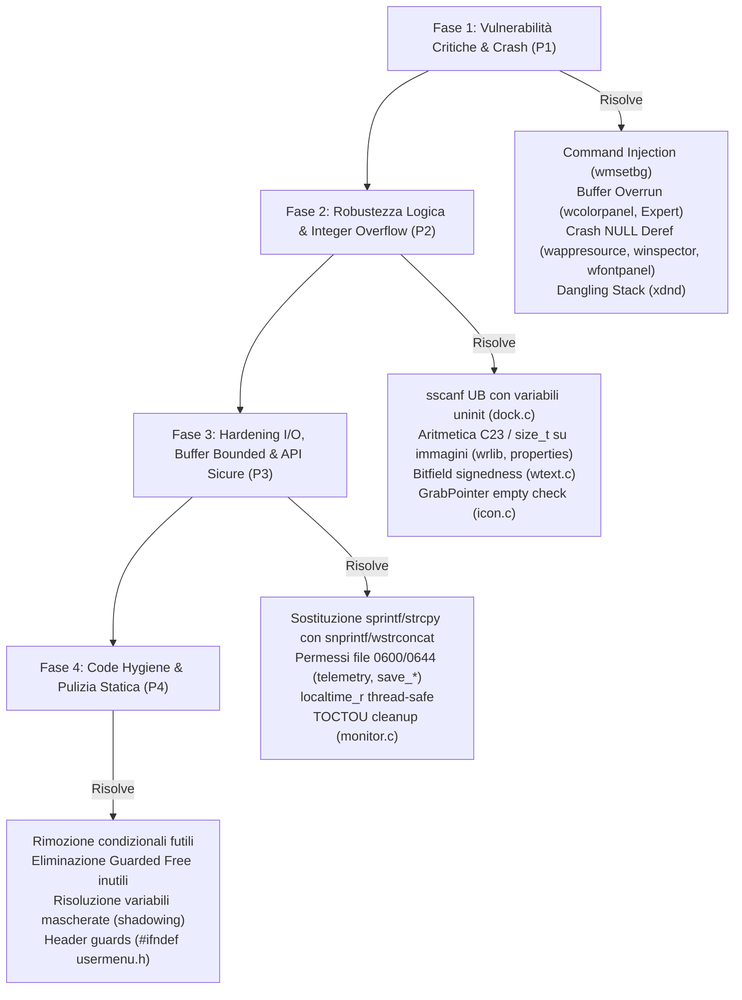

# Analisi Statica del Codice CodeQL e Piano di Correzione (QLCODEReport.md)

**Data:** 2026-11-05  
**Directory analizzata:** `QLCodeAnalysis/` (`wmaker-results.csv`, `wmaker-results.sarif`, `report.html`, database `wmaker-db`)  
**Autore:** Gemini (per Andrea Gelmini)  
**Branch:** `gelma`  
**Progetto:** Window Maker (`wmaker_git`)  

---

## 1. Executive Summary & Quadro Generale

L'esecuzione della suite di analisi statica **GitHub CodeQL (C/C++ query pack)** sull'intero codebase di Window Maker ha prodotto un totale di **563 segnalazioni**, ripartite in tre livelli di severità:
- **Error (Critici / Bug ad alto impatto / Vulnerabilità)**: **53**
- **Warning (Avvisi di sicurezza, conversioni e robustezza)**: **179**
- **Recommendation (Code hygiene, stile e best practice)**: **331**

### Ripartizione delle Segnalazioni per Componente del Repository

| Modulo / Directory | Ruolo Architetturale | Error | Warning | Recommendation | Totale Segnalazioni |
|:---|:---|:---:|:---:|:---:|:---:|
| **`src/`** | Core Window Manager (event loop, dock, menu, window management) | 13 | 67 | 131 | **211** |
| **`WINGs/`** | Toolkit grafico NEXTSTEP-like (widget, allocatori, proplist) | 28 | 29 | 91 | **148** |
| **`util/`** | Utility a riga di comando (`wmsetbg`, `wmagnify`, `getstyle`, `xdnd`) | 3 | 25 | 57 | **85** |
| **`WPrefs.app/`** | Applicazione di configurazione grafica di Window Maker | 7 | 38 | 34 | **79** |
| **`wrlib/`** | Libreria grafica di rasterizzazione immagini e texture | 2 | 20 | 16 | **38** |
| **`wmlib/`** | Libreria client legacy X11 | 0 | 0 | 2 | **2** |
| **TOTALE** | | **53** | **179** | **331** | **563** |

---

### Mappatura per Standard di Sicurezza CWE (Common Weakness Enumeration)

L'analisi dei metadati SARIF evidenzia la presenza di classi di rischio standardizzate a livello internazionale:
- **CWE-078 / CWE-088 (OS Command Injection)**: Passaggio di dati derivati da input utente a `system()` senza isolamento dei metacaratteri shell (`wmsetbg.c`).
- **CWE-120 / CWE-787 / CWE-805 (Buffer Overrun / Out-of-bounds Write)**: `sprintf()` e `strcpy()` su buffer a dimensione fissa sottodimensionati (`wcolorpanel.c`, `Expert.c`, `WPrefs.c`).
- **CWE-476 (NULL Pointer Dereference)**: Mancata verifica del valore di ritorno di chiamate a librerie X11 o funzioni interne prima della dereferenziazione (`wappresource.c`, `wfontpanel.c`, `winspector.c`, `dock.c`).
- **CWE-190 / CWE-192 / CWE-681 (Integer Overflow to Buffer Size)**: Moltiplicazioni di dimensioni immagine (`width * height * bpp`) in aritmetica a 32-bit prima della conversione a `size_t` per `malloc()` o `memcpy()`.
- **CWE-252 / CWE-253 (Unchecked Return Value / Uninitialized Variables)**: Valore di ritorno di `sscanf()` non verificato seguito da uso di variabili automatiche non inizializzate (`dock.c:4986`).
- **CWE-562 (Stack Address Escape)**: Memorizzazione dell'indirizzo di una variabile allocata sullo stack in una struttura globale a vita indefinita (`xdnd.c:1596`).
- **CWE-732 (Insecure File Permissions)**: Creazione di file senza restrizione esplicita della maschera di permessi (`0666` potenziale world-writable).
- **CWE-367 (Time-of-check Time-of-use / TOCTOU)**: Chiamate `access()`/`stat()` separate da successive operazioni atomiche su file (`monitor.c`, `wfilepanel.c`).

---

## 2. Matrice di Priorità di Intervento (Roadmap Ingegneristica)

Per garantire la massima sicurezza e stabilità senza regressioni, il piano di intervento è strutturato in 4 fasi:



---

## 3. Analisi Dettagliata delle Anomalie Critiche (Severità: ERROR - 53 casi)

### 3.1. OS Command Injection (CWE-78)
- **File & Riga:** [`util/wmsetbg.c:1045`](file:///home/gelma/dev/prg/intelligenti/wmaker/wmaker_git/util/wmsetbg.c#L1045)
- **Descrizione:** La funzione `updateDomain(const char *domain, const char *key, const char *texture)` riceve l'argomento `domain` (derivato dai parametri da riga di comando passati dall'utente, es. opzione `-d`) e costruisce una stringa di comando tramite `snprintf(cmd_smooth, sizeof(cmd_smooth), "wdwrite %s SmoothWorkspaceBack %s", domain, ...)` che passa direttamente a `system(cmd_smooth)`.
- **Rischio:** Se `domain` contiene caratteri speciali di shell (`;&|` o backtick o `$()`), la shell `/bin/sh` esegue comandi arbitrari con i privilegi dell'utente.
- **Verdetto:** **BUG REALE DI SICUREZZA (Vulnerabilità Critica)**.
- **Correzione proposta:**
  Sostituire la chiamata a `system()` con un'esecuzione diretta sicura (tramite `fork()` e `execlp("wdwrite", "wdwrite", domain, "SmoothWorkspaceBack", smooth ? "YES" : "NO", NULL)`), analogamente a quanto già fatto poche righe sotto con l'altra chiamata a `execlp`:
  ```c
  pid_t pid = fork();
  if (pid == 0) {
      execlp("wdwrite", "wdwrite", domain, "SmoothWorkspaceBack", smooth ? "YES" : "NO", NULL);
      _exit(127);
  } else if (pid > 0) {
      waitpid(pid, NULL, 0);
  }
  ```

---

### 3.2. Buffer Overrun in `sprintf` su Buffer Fissi (CWE-120 / CWE-787)

#### A. WINGs Color Panel: 17 istanze di `char tmp[4]`
- **File & Righe:** [`WINGs/wcolorpanel.c:3436, 3438, 3440, 3383, 2616, 2618, 2620, 2576, 2579, 2582, 2585, 2533, 2535, 2537, 2539, 2332, 2307`](file:///home/gelma/dev/prg/intelligenti/wmaker/wmaker_git/WINGs/wcolorpanel.c#L3436)
- **Descrizione:** In molteplici funzioni di aggiornamento del pannello colori (`cmykInit`, `rgbInit`, `hsbInit`, `sliderChangedCallback`), viene dichiarato un buffer locale sullo stack `char tmp[4];`. Successivamente viene eseguito:
  ```c
  sprintf(tmp, "%d", value[0]);
  ```
  La specifica `%d` per un tipo intero con segno a 32-bit (`int`) richiede fino a 12 byte (`-2147483648\0`). Anche ipotizzando valori 0-100, un valore anomalo, un arrotondamento imprevisto da calcoli floating point (`rint((255 - panel->color.rgb.red) / 2.55)`) o valori fuori scala producono un overflow immediato della memoria dello stack.
- **Verdetto:** **BUG REALE (Stack Buffer Overflow Hazard)**.
- **Correzione proposta:**
  Dichiarare il buffer locale con dimensione sicura `char tmp[16];` o `char tmp[32];` e utilizzare `snprintf(tmp, sizeof(tmp), "%d", value[i]);`.

#### B. WPrefs Expert Panel: `char tmp[10]` per valori interi
- **File & Riga:** [`WPrefs.app/Expert.c:411`](file:///home/gelma/dev/prg/intelligenti/wmaker/wmaker_git/WPrefs.app/Expert.c#L411)
- **Descrizione:**
  ```c
  char tmp[10];
  ...
  state = GetIntegerForKey(expert_options[i].op_name);
  sprintf(tmp, "%d", state);
  ```
  Un intero a 32 bit può occupare fino a 11 caratteri numerici più il terminatore nullo (12 byte complessivi). Il buffer di soli 10 byte va in overflow per qualsiasi intero `<= -1000000000` o `>= 1000000000`.
- **Verdetto:** **BUG REALE (Stack Buffer Overflow)**.
- **Correzione proposta:**
  Portare la dimensione del buffer a `char tmp[32];` e usare `snprintf(tmp, sizeof(tmp), "%d", state);`.

---

### 3.3. Dereferenziazioni Inconsistenti di Puntatori NULL (CWE-476 - 16 casi)

La seguente tabella riassume i punti in cui chiamate di sistema o di libreria possono restituire `NULL` e vengono dereferenziate senza verifica:

| File e Riga | Chiamata Funzione | Rischio e Contesto Operativo | Verdetto & Azione Correttiva |
|:---|:---|:---|:---|
| [`WINGs/wappresource.c:18`](file:///home/gelma/dev/prg/intelligenti/wmaker/wmaker_git/WINGs/wappresource.c#L18) | `XGetWMHints(scr->display, scr->groupLeader)` | `hints->flags \|= IconWindowHint;` dereferenzia `hints` senza null-check. Se l'applicazione non ha hints o allocazione fallisce, crash istantaneo con SIGSEGV. | **BUG REALE**: Se `!hints`, allocare con `XAllocWMHints()` oppure verificare `if (hints)`. |
| [`WINGs/wappresource.c:64`](file:///home/gelma/dev/prg/intelligenti/wmaker/wmaker_git/WINGs/wappresource.c#L64) | `XGetWMHints(scr->display, scr->groupLeader)` | Analogo al precedente per impostazione dell'icona WINGs. | **BUG REALE**: Stessa correzione con allocazione/check difensivo. |
| [`WINGs/wfontpanel.c:696, 738, 767, 793`](file:///home/gelma/dev/prg/intelligenti/wmaker/wmaker_git/WINGs/wfontpanel.c#L767) | `WMGetListSelectedItem(panel->...)` | Se l'utente clicca una lista vuota o una selezione viene invalidata, la funzione ritorna `NULL`. Il codice dereferenzia subito `item->clientData` o `item->text`. | **BUG REALE (UI Crash)**: Inserire `if (!item) return;` all'inizio delle relative callback. |
| [`src/winspector.c:1440`](file:///home/gelma/dev/prg/intelligenti/wmaker/wmaker_git/src/winspector.c#L1440) | `wapp = wApplicationOf(wwin->main_window)` | `get_attr_flag(&wapp->main_window_desc->...)` dereferenzia `wapp` senza verificare se la finestra appartiene a un'applicazione registrata. | **BUG REALE**: Introdurre guardia `if (!wapp) return;` o visualizzare solo attributi validi. |
| [`src/dock.c:823`](file:///home/gelma/dev/prg/intelligenti/wmaker/wmaker_git/src/dock.c#L823) | `wapp = wApplicationOf(btn->icon->owner->main_window)` | Se l'app non è presente o è un dockapp orfano, `wapp` può essere `NULL`. Linea 825: `if (wapp->flags.hidden)`. | **BUG REALE**: Modificare in `if (wapp && wapp->flags.hidden)`. |
| [`WPrefs.app/TexturePanel.c:212`](file:///home/gelma/dev/prg/intelligenti/wmaker/wmaker_git/WPrefs.app/TexturePanel.c#L212) | `image = RCloneImage(panel->image)` | In caso di esaurimento memoria grafico, `image` è `NULL` e la successiva lettura di `image->width` causa SIGSEGV. | **BUG REALE**: Verificare `if (!image) return;`. |
| [`WPrefs.app/editmenu.c:653`](file:///home/gelma/dev/prg/intelligenti/wmaker/wmaker_git/WPrefs.app/editmenu.c#L653) | `hints = XAllocSizeHints()` | Dereferenziato direttamente con `hints->flags = USPosition;`. | **BUG DIFENSIVO**: Verificare `if (!hints) return;`. |
| [`util/wmagnify.c:207`](file:///home/gelma/dev/prg/intelligenti/wmaker/wmaker_git/util/wmagnify.c#L207) | `image = XGetImage(...)` | In coordinate non valide o fallimento X11, `image` è `NULL` e il loop accede a `image->data`. | **BUG REALE**: Aggiungere guardia `if (!image) return;`. |
| [`src/window.c:2032`](file:///home/gelma/dev/prg/intelligenti/wmaker/wmaker_git/src/window.c#L2032) | `oowner = wWindowFor(owin->transient_for)` | Viene effettuato solo il confronto di puntatori `if (wwin == oowner)`. | **FALSO POSITIVO**: Non c'è dereferenziazione di `oowner`. |
| [`src/event.c:1388`](file:///home/gelma/dev/prg/intelligenti/wmaker/wmaker_git/src/event.c#L1388) | `scr = wScreenWithNumber(i)` | Indice di schermo delimitato da `w_global.screen_count`. | **FALSO POSITIVO**: `scr` è sempre valido, ma `if (!scr) continue;` è raccomandato. |

---

### 3.4. Fuga di Indirizzi dello Stack in Memoria Non Locale (CWE-562)
- **File & Riga:** [`util/xdnd.c:1596`](file:///home/gelma/dev/prg/intelligenti/wmaker/wmaker_git/util/xdnd.c#L1596)
- **Codice sorgente:**
  ```c
  struct xdnd_get_drop_info i;
  ...
  memset(&i, 0, sizeof(i));
  i.actionlist = actionlist;
  i.typelist = typelist;
  dnd.user_hook1 = &i; /* dnd e' una variabile statica/globale */
  ```
- **Descrizione:** La struttura `i` è allocata nello stack del frame di funzione corrente. Il suo indirizzo `&i` viene salvato in `dnd.user_hook1`, che appartiene al contesto globale `static xdnd_context dnd;`. All'uscita della funzione, il frame dello stack viene deallocato e riutilizzato: se `dnd.user_hook1` viene letto successivamente, si verifica una lettura di memoria dangling (Use-After-Return) con comportamento indefinito o crash.
- **Verdetto:** **BUG REALE (Dangling Pointer / Stack Escape)**.
- **Correzione proposta:**
  Allocare la struttura con `malloc()` o azzerare esplicitamente `dnd.user_hook1 = NULL;` al termine del ciclo principale prima del `return` della funzione.

---

### 3.5. Unbounded Writes e Manipolazione di Stringhe (CWE-120 / CWE-787)
- **`WPrefs.app/WPrefs.c:707, 711`**:
  `sprintf(mbuf, _("Window Maker domain (%s) is corrupted!"), buffer);`
  dove `mbuf` è `char mbuf[1069];` e `buffer` è riempito con `fgets(buffer, 1023, file) + strcat(buffer, "/WindowMaker")`. Con stringhe localizzate lunghe in lingue verbose (es. tedesco/francese) e path lunghi, si verifica un buffer overflow.
  *Correzione*: Usare `snprintf(mbuf, sizeof(mbuf), ...)`.
- **`src/dialog.c:702` & `src/rootmenu.c:1306, 1386, 1422`**:
  Sequenze di `strcpy()` e multipli `strcat()` per comporre percorsi di menu ed icone (`strcpy(path, tmp); strcat(path, "/"); strcat(path, iconFile);`).
  *Correzione*: Standardizzare sull'helper robusto `wstrconcat()` o `snprintf()`.
- **`wrlib/load.c:272, 291`**:
  `RImageCache[i].file = malloc(strlen(file) + 1); strcpy(RImageCache[i].file, file);`
  *Correzione*: Sostituire con `RImageCache[i].file = wstrdup(file);`.

---

## 4. Analisi dei Warning Rilevanti (Severità: WARNING - 179 casi)

### 4.1. Mancata Verifica del Valore di Ritorno di `sscanf` ed Uso di Variabili Uninitialized (CWE-252)

#### Caso Critico in `src/dock.c:4986, 4989`
- **Codice:**
  ```c
  int x, y, y_index;
  if (sscanf(WMGetFromPLString(value), "%i,%i", &x, &y) != 2)
      COMPLAIN("Position");

  /* check position sanity */
  if (x != scr->dock->x_pos) { ... }
  y_index = (y - scr->dock->y_pos) / ICON_SIZE;
  ```
- **Analisi Tecnica:**
  La macro `COMPLAIN(key)` stampa solo un messaggio di warning su log (`wwarning(...)`), **senza interrompere l'esecuzione**. Se il valore nel file di stato del dock è malformato, `sscanf()` non scrive in `x` e `y`. Le righe successive eseguono letture di `x` e calcoli con `y` su **dati non inizializzati dello stack**, portando a calcoli corrotti di `y_index` e potenziale corruzione della memoria delle icone del dock!
- **Verdetto:** **BUG REALE (Undefined Behavior / Crash Hazard)**.
- **Correzione:** Inizializzare `int x = 0, y = 0, y_index = 0;` e, in caso di fallimento di `sscanf`, eseguire un `continue` o applicare i valori di default di salvataggio.

#### Altri casi analoghi:
- **`src/appmenu.c:149`**: Uso di `sscanf` con specificatore `%n` (`&pos`). Se la stringa si interrompe prima del punto misurato, `pos` non viene scritta e l'accesso `slist[*index][pos]` provoca un buffer out-of-bounds read. *Correzione: Inizializzare `int pos = 0;`*.
- **`WPrefs.app/WPrefs.c:665`**: Parsing della stringa di versione con due `sscanf` in cascata. Se entrambe falliscono o sono parziali, `v1, v2, v3` possono essere lette non inizializzate. *Correzione: Inizializzare `int v1 = 0, v2 = 0, v3 = 0;`*.

---

### 4.2. Overflow nei Calcoli di Dimensioni per Allocazioni di Memoria (CWE-190 - 25 casi)

In ben 25 posizioni, prevalentemente in `wrlib` e nel gestore proprietà X11, i calcoli del numero totale di byte da allocare vengono eseguiti con moltiplicazioni di interi a 32-bit:
```c
/* Esempi tipici evidenziati da CodeQL: */
wrlib/load_jpeg.c:121:  buffer[0] = (JSAMPROW) malloc(cinfo->image_width * cinfo->num_components);
wrlib/load_tiff.c:90:   ptr = data = (uint32_t *) _TIFFmalloc(width * height * sizeof(uint32_t));
wrlib/load_webp.c:148:  features.width * features.height * 4
wrlib/raster.c:219:     memcpy(new_image->data, image->data, image->width * image->height * (HAS_ALPHA(image) ? 4 : 3));
src/properties.c:197:   memcpy(&tmp[4], image->data, image->width * image->height * 4);
src/dock.c:3004:        slot_map = wmalloc(mwidth * mwidth);
```
- **Rischio:** Se un'immagine, un'icona EWMH o una texture possiede dimensioni elevate o craftate da un attaccante (es. $46341 \times 46341 \times 4$), il prodotto a 32 bit fa wrap-around a un valore piccolo. Viene allocato un buffer insufficiente e la successiva scrittura pixel distrugge l'heap.
- **Correzione:** Eseguire il cast preventivo a `size_t` prima della moltiplicazione:
  ```c
  (size_t)image->width * (size_t)image->height * 4
  ```
  oppure, in prospettiva di allineamento C23 (documentato in `SpecAI.md`), utilizzare `<stdckdint.h>` con `ckd_mul()`.

---

### 4.3. Uncontrolled Process Operation & Script Execution (CWE-078 / CWE-114 - 7 casi)
- **File & Righe:** [`src/main.c:557, 575`](file:///home/gelma/dev/prg/intelligenti/wmaker/wmaker_git/src/main.c#L557)
- **Codice:**
  ```c
  void ExecInitScript(void) {
      ...
      file = wfindfile(paths, DEF_INIT_SCRIPT);
      if (file) {
          if (system(file) != 0) ...
  ```
- **Descrizione:** Gli script di avvio (`autostart`) e chiusura (`exitscript`) vengono eseguiti tramite `system(file)`. Se il percorso di configurazione o la home dell'utente contiene spazi o caratteri di escape, la chiamata `system()` si rompe o esegue segmenti non voluti.
- **Correzione:** Eseguire lo script racchiudendo il percorso tra virgolette o, preferibilmente, invocando un'esecuzione POSIX con `fork()` ed `execl()`.

---

### 4.4. Bitfield con Segno Ambiguo (CWE-197)
- **File & Riga:** [`WINGs/wtext.c:75`](file:///home/gelma/dev/prg/intelligenti/wmaker/wmaker_git/WINGs/wtext.c#L75)
- **Codice:** `int script:8; /* script in points: negative for subscript */`
- **Descrizione:** Nello standard C ANSI/ISO, il tipo `int` all'interno di un bitfield ha un signedness implementato dal compilatore (può essere trattato come `unsigned int` a seconda dell'architettura e dei flag del compilatore). Poiché il commento e la logica richiedono esplicitamente valori negativi per i pedici (subscript), l'uso di `int` è ambiguo e pericoloso.
- **Correzione:** Dichiarare esplicitamente `signed int script:8;`.

---

### 4.5. Loop Infinite Hazard su Tipi Stretti (CWE-835)
- **File & Riga:** [`src/wsmap.c:358`](file:///home/gelma/dev/prg/intelligenti/wmaker/wmaker_git/src/wsmap.c#L358)
- **Codice:**
  ```c
  unsigned short workspace_index;
  int mini_workspace_cnt;
  ...
  for (workspace_index = 0; workspace_index < mini_workspace_cnt; workspace_index++)
  ```
- **Descrizione:** Confronto tra un contatore a 16 bit senza segno (`unsigned short`, max 65535) e un limite intero a 32 bit con segno (`int`). Se `mini_workspace_cnt` superasse tale soglia, il loop diventerebbe infinito a causa del wrap-around a zero.
- **Correzione:** Dichiarare `int workspace_index;`.

---

### 4.6. Funzioni Obsolete / Non Thread-Safe (CWE-676)
- **Istanze:** `src/dialog.c:1268`, `src/screen.c:1314`, `src/telemetry.c:394, 530`.
- **Descrizione:** Uso della funzione di libreria C standard `localtime()`, che restituisce un puntatore a un buffer statico interno condiviso.
- **Correzione:** Migrare sistematicamente a `localtime_r(const time_t *timep, struct tm *result)`.

---

### 4.7. File Creati Senza Restrizione dei Permessi (CWE-732 - 10 casi)
- **Istanze:** `src/telemetry.c:252, 446, 526`, `util/wmiv.c:508`, `wrlib/save_jpeg.c:185`, `wrlib/save_png.c:199`, `wrlib/save_xpm.c:176`.
- **Descrizione:** File aperti o creati con `fopen(path, "w")` che assumono la umask di default del processo, con il rischio di generare file world-writable o accessibili a terzi.
- **Correzione:** Nelle utility e nei file di salvataggio/telemetria, forzare una maschera restrittiva o usare `open(path, O_WRONLY | O_CREAT | O_TRUNC, 0600)` prima di associare un `fdopen()`.

---

## 5. Analisi delle Raccomandazioni e Code Hygiene (331 casi)

### 5.1. Condizionali Futili e Branch Vuoti Pericolosi (17 casi)
CodeQL segnala diversi blocchi `if` senza istruzioni. Molti di essi (`src/motif.c:107, 121, 142`) sono documentativi per indicare che Window Maker ignora deliberatamente determinati hint MWM.
Tuttavia, **un caso in `src/icon.c:932` rappresenta un'omissione critica**:
```c
if (XGrabPointer(dpy, icon->core->window, False, ButtonMotionMask
                 | ButtonReleaseMask | ButtonPressMask, GrabModeAsync,
                 GrabModeAsync, None, None, CurrentTime) != GrabSuccess) {
}
while (1) {
    WMMaskEvent(dpy, PointerMotionMask | ButtonReleaseMask | ButtonPressMask
                | ButtonMotionMask | ExposureMask, &ev);
```
Se `XGrabPointer` **fallisce**, il blocco dell'istruzione condizionale è vuoto e l'esecuzione prosegue entrando direttamente nel loop infinito `while (1)`, bloccando l'interazione con l'utente o non ricevendo mai gli eventi attesi!
- **Azione:** Inserire `return;` all'interno del ramo di fallimento di `XGrabPointer`.

### 5.2. Header Guard Mancante
- **File:** [`src/usermenu.h`](file:///home/gelma/dev/prg/intelligenti/wmaker/wmaker_git/src/usermenu.h)
- **Descrizione:** L'include guard `#ifndef _WUSERMENU_H_` è posizionato all'interno di una direttiva condizionale `#ifdef USER_MENU`.
- **Correzione:** Spostare `#ifndef _WUSERMENU_H_` all'inizio assoluto del file header prima di ogni altro `#ifdef`.

### 5.3. Guarded Free Inutili (22 casi)
In `src/dock.c:3419`, `src/session.c:272`, `src/window.c:3569`, ecc., compaiono istruzioni come:
```c
if (ptr)
    free(ptr);
```
Nello standard C, `free(NULL)` è un'operazione sicura e definita come no-op. Il check `if (ptr)` è ridondante e può essere rimosso.

### 5.4. Commented-out Code (118 casi)
Centinaia di righe di codice storico (`/* printf(...); */` o frammenti di codice risalenti agli anni '90) appesantiscono la lettura e la manutenzione. Verranno ripulite progressivamente durante i refactoring dei singoli moduli.

---

## 6. Piano Operativo di Bonifica Dettagliato

### Step 1: Sicurezza Immediata & Riparazione Crash (Priorità P1)
1. **`util/wmsetbg.c`**: Riscrivere `updateDomain()` eliminando `system()` a favore di un'invocazione controllata senza interprete di shell.
2. **`WINGs/wcolorpanel.c`**: Ampliare `char tmp[4]` a `char tmp[32]` con `snprintf()` in tutti i 17 punti di conversione intero.
3. **`WPrefs.app/Expert.c`**: Portare `char tmp[10]` a `char tmp[32]`.
4. **`util/xdnd.c`**: Risolvere la fuga di puntatore dello stack azzerando `dnd.user_hook1` al termine della routine di drop.
5. **Guardie NULL Pointer**: Introdurre i controlli `if (!hints)`, `if (!item)`, `if (!wapp)` in `WINGs/wappresource.c`, `WINGs/wfontpanel.c`, `src/winspector.c`, `src/dock.c:823`.

### Step 2: Integrità Logica & Undefined Behavior (Priorità P2)
1. **`src/dock.c:4986`**: Inizializzare le variabili `x, y` e gestire correttamente il fallimento di `sscanf()`.
2. **`src/icon.c:932`**: Gestire il fallimento di `XGrabPointer()` con `return;` immediato prima del loop di masking eventi.
3. **`wrlib/` e `src/properties.c`**: Applicare il cast `(size_t)` sui calcoli di memoria delle immagini prima di `malloc()` / `memcpy()`.
4. **`WINGs/wtext.c:75`**: Dichiarare `signed int script:8;`.
5. **`src/wsmap.c:358`**: Modificare il contatore di ciclo in `int workspace_index;`.

### Step 3: Hardening di Sistema & Pulizia API (Priorità P3)
1. **`src/main.c:557, 575`**: Mettere in sicurezza l'esecuzione di script di avvio ed uscita.
2. **`WPrefs.app/WPrefs.c`**: Sostituire le chiamate a `sprintf()` non limitate con `snprintf()`.
3. **Thread Safety**: Aggiornare `localtime` in `localtime_r` nei moduli core e di telemetria.
4. **Header Guard**: Correggere `src/usermenu.h`.

---

## 7. Conclusioni

Il report generato da CodeQL ha identificato diverse problematiche concrete di sicurezza e stabilità (in particolare la command injection in `wmsetbg.c`, il potenziale stack corruption in `wcolorpanel.c`, il branch vuoto in `icon.c`, e variabili non inizializzate a seguito di fallimento di `sscanf` in `dock.c`).

L'implementazione delle correzioni secondo le fasi sopra pianificate consentirà di innalzare il livello qualitativo e di sicurezza di Window Maker, mantenendo la totale compatibilità operativa e predisponendo la base per il futuro allineamento ai moderni standard C.
