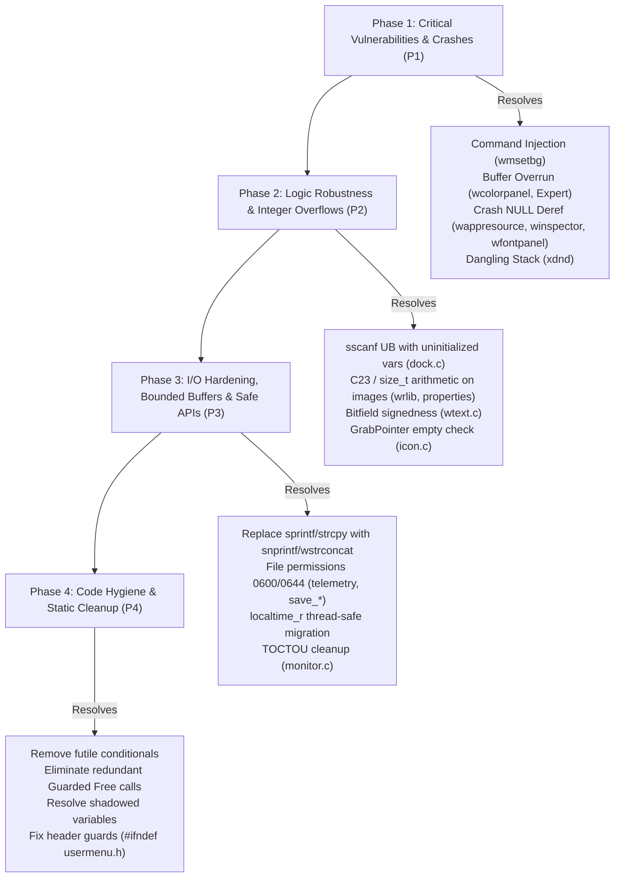

# CodeQL Static Analysis Report & Remediation Plan (QLCODEReport.md)

**Date:** 2026-11-05  
**Directory Analyzed:** `QLCodeAnalysis/` (`wmaker-results.csv`, `wmaker-results.sarif`, `report.html`, database `wmaker-db`)  
**Author:** Gemini (for Andrea Gelmini)  
**Branch:** `gelma`  
**Project:** Window Maker (`wmaker_git`)  

---

## 1. Executive Summary & Overview

Running the **GitHub CodeQL (C/C++ query pack)** static analysis suite across the Window Maker codebase produced a total of **563 findings**, classified into three severity levels:
- **Error (Critical / High-impact defects / Vulnerabilities)**: **53**
- **Warning (Security, integer conversions, and robustness notices)**: **179**
- **Recommendation (Code hygiene, style, and best practices)**: **331**

### Findings Breakdown by Repository Component

| Module / Directory | Architectural Role | Error | Warning | Recommendation | Total Findings |
|:---|:---|:---:|:---:|:---:|:---:|
| **`src/`** | Core Window Manager (event loop, dock, menus, window management) | 13 | 67 | 131 | **211** |
| **`WINGs/`** | NEXTSTEP-like GUI toolkit (widgets, allocators, proplist) | 28 | 29 | 91 | **148** |
| **`util/`** | Command-line utilities (`wmsetbg`, `wmagnify`, `getstyle`, `xdnd`) | 3 | 25 | 57 | **85** |
| **`WPrefs.app/`** | Window Maker graphical configuration application | 7 | 38 | 34 | **79** |
| **`wrlib/`** | Raster graphics library (image decoding, transformations, textures) | 2 | 20 | 16 | **38** |
| **`wmlib/`** | Legacy X11 client library | 0 | 0 | 2 | **2** |
| **TOTAL** | | **53** | **179** | **331** | **563** |

---

### Common Weakness Enumeration (CWE) Mapping

Analysis of the SARIF metadata identifies standardized international vulnerability and weakness classes:
- **CWE-078 / CWE-088 (OS Command Injection)**: User-controlled input passed to `system()` without shell metacharacter sanitization or isolation (`wmsetbg.c`).
- **CWE-120 / CWE-787 / CWE-805 (Buffer Overrun / Out-of-bounds Write)**: `sprintf()` and `strcpy()` operations writing into undersized, fixed-size stack buffers (`wcolorpanel.c`, `Expert.c`, `WPrefs.c`).
- **CWE-476 (NULL Pointer Dereference)**: Missing return value validation for X11 library functions or internal allocators prior to dereferencing (`wappresource.c`, `wfontpanel.c`, `winspector.c`, `dock.c`).
- **CWE-190 / CWE-192 / CWE-681 (Integer Overflow to Buffer Size)**: Image dimension arithmetic (`width * height * bpp`) evaluated using 32-bit integer arithmetic before conversion to `size_t` for `malloc()` or `memcpy()`.
- **CWE-252 / CWE-253 (Unchecked Return Value / Uninitialized Variables)**: Return value of `sscanf()` ignored or inadequately handled, leading to reads of uninitialized stack variables (`dock.c:4986`).
- **CWE-562 (Stack Address Escape)**: Address of a stack-allocated local structure stored in a global variable with indefinite lifetime (`xdnd.c:1596`).
- **CWE-732 (Insecure File Permissions)**: Files created without restrictive permission masks (`0666` potentially world-writable).
- **CWE-367 (Time-of-check Time-of-use / TOCTOU)**: Non-atomic `access()`/`stat()` checks preceding filesystem modifications (`monitor.c`, `wfilepanel.c`).

---

## 2. Remediation Priority Matrix (Engineering Roadmap)

To maintain maximum safety and prevent regressions, the remediation plan is structured into four sequential phases:



---

## 3. Detailed Analysis of Critical Findings (Severity: ERROR - 53 findings)

### 3.1. OS Command Injection (CWE-78)
- **File & Line:** [`util/wmsetbg.c:1045`](file:///home/gelma/dev/prg/intelligenti/wmaker/wmaker_git/util/wmsetbg.c#L1045)
- **Description:** The function `updateDomain(const char *domain, const char *key, const char *texture)` receives the `domain` parameter (derived from user-supplied command-line options, e.g. `-d`) and formats a shell command string using `snprintf(cmd_smooth, sizeof(cmd_smooth), "wdwrite %s SmoothWorkspaceBack %s", domain, ...)`, which is directly executed via `system(cmd_smooth)`.
- **Risk:** If `domain` contains shell metacharacters (`;`, `&`, `|`, backticks, or `$()`), `/bin/sh` executes arbitrary commands with user privileges.
- **Verdict:** **REAL SECURITY DEFECT (Critical Vulnerability)**.
- **Proposed Remediation:**
  Replace `system()` with direct process execution without a shell via `fork()` and `execlp("wdwrite", "wdwrite", domain, "SmoothWorkspaceBack", smooth ? "YES" : "NO", NULL)`, matching the pattern already used two lines below:
  ```c
  pid_t pid = fork();
  if (pid == 0) {
      execlp("wdwrite", "wdwrite", domain, "SmoothWorkspaceBack", smooth ? "YES" : "NO", NULL);
      _exit(127);
  } else if (pid > 0) {
      waitpid(pid, NULL, 0);
  }
  ```

---

### 3.2. Buffer Overrun in `sprintf` with Fixed Buffers (CWE-120 / CWE-787)

#### A. WINGs Color Panel: 17 instances of `char tmp[4]`
- **File & Lines:** [`WINGs/wcolorpanel.c:3436, 3438, 3440, 3383, 2616, 2618, 2620, 2576, 2579, 2582, 2585, 2533, 2535, 2537, 2539, 2332, 2307`](file:///home/gelma/dev/prg/intelligenti/wmaker/wmaker_git/WINGs/wcolorpanel.c#L3436)
- **Description:** Across several color panel update routines (`cmykInit`, `rgbInit`, `hsbInit`, `sliderChangedCallback`), a local stack buffer is declared as `char tmp[4];`. The code subsequently calls:
  ```c
  sprintf(tmp, "%d", value[0]);
  ```
  The `%d` format specifier for a signed 32-bit integer (`int`) can require up to 12 bytes (`-2147483648\0`). Even assuming nominal 0–100 ranges, out-of-range inputs or floating-point rounding anomalies (`rint((255 - panel->color.rgb.red) / 2.55)`) will overrun the stack buffer.
- **Verdict:** **REAL DEFECT (Stack Buffer Overflow Hazard)**.
- **Proposed Remediation:**
  Expand the local buffer to a safe size such as `char tmp[16];` or `char tmp[32];`, and enforce bounded formatting via `snprintf(tmp, sizeof(tmp), "%d", value[i]);`.

#### B. WPrefs Expert Panel: `char tmp[10]` for integer values
- **File & Line:** [`WPrefs.app/Expert.c:411`](file:///home/gelma/dev/prg/intelligenti/wmaker/wmaker_git/WPrefs.app/Expert.c#L411)
- **Description:**
  ```c
  char tmp[10];
  ...
  state = GetIntegerForKey(expert_options[i].op_name);
  sprintf(tmp, "%d", state);
  ```
  A signed 32-bit integer can produce up to 11 digits plus the null terminator (12 bytes total). A 10-byte buffer overruns for any value `<= -1000000000` or `>= 1000000000`.
- **Verdict:** **REAL DEFECT (Stack Buffer Overflow)**.
- **Proposed Remediation:**
  Expand the buffer to `char tmp[32];` and format with `snprintf(tmp, sizeof(tmp), "%d", state);`.

---

### 3.3. Inconsistent NULL Pointer Dereferences (CWE-476 - 16 findings)

The table below summarizes call sites where system or library functions can return `NULL` and are dereferenced without prior checks:

| File and Line | Function Call | Context & Failure Mode | Verdict & Remediation |
|:---|:---|:---|:---|
| [`WINGs/wappresource.c:18`](file:///home/gelma/dev/prg/intelligenti/wmaker/wmaker_git/WINGs/wappresource.c#L18) | `XGetWMHints(scr->display, scr->groupLeader)` | `hints->flags \|= IconWindowHint;` dereferences `hints` unchecked. If the window lacks hints or allocation fails, SIGSEGV occurs. | **REAL DEFECT**: If `!hints`, allocate via `XAllocWMHints()` or guard with `if (hints)`. |
| [`WINGs/wappresource.c:64`](file:///home/gelma/dev/prg/intelligenti/wmaker/wmaker_git/WINGs/wappresource.c#L64) | `XGetWMHints(scr->display, scr->groupLeader)` | Identical pattern for WINGs icon setup. | **REAL DEFECT**: Same fix using allocation or defensive check. |
| [`WINGs/wfontpanel.c:696, 738, 767, 793`](file:///home/gelma/dev/prg/intelligenti/wmaker/wmaker_git/WINGs/wfontpanel.c#L767) | `WMGetListSelectedItem(panel->...)` | If a list is empty or selection is cleared, returns `NULL`. The callback immediately dereferences `item->clientData` or `item->text`. | **REAL DEFECT (UI Crash)**: Add `if (!item) return;` at callback entry. |
| [`src/winspector.c:1440`](file:///home/gelma/dev/prg/intelligenti/wmaker/wmaker_git/src/winspector.c#L1440) | `wapp = wApplicationOf(wwin->main_window)` | `get_attr_flag(&wapp->main_window_desc->...)` dereferences `wapp` without checking if the window belongs to a registered application. | **REAL DEFECT**: Add guard `if (!wapp) return;`. |
| [`src/dock.c:823`](file:///home/gelma/dev/prg/intelligenti/wmaker/wmaker_git/src/dock.c#L823) | `wapp = wApplicationOf(btn->icon->owner->main_window)` | If application is absent or dockapp is orphaned, `wapp` can be `NULL`. Line 825 evaluates `if (wapp->flags.hidden)`. | **REAL DEFECT**: Change check to `if (wapp && wapp->flags.hidden)`. |
| [`WPrefs.app/TexturePanel.c:212`](file:///home/gelma/dev/prg/intelligenti/wmaker/wmaker_git/WPrefs.app/TexturePanel.c#L212) | `image = RCloneImage(panel->image)` | On OOM, `image` is `NULL` and `image->width` dereferences null pointer. | **REAL DEFECT**: Guard with `if (!image) return;`. |
| [`WPrefs.app/editmenu.c:653`](file:///home/gelma/dev/prg/intelligenti/wmaker/wmaker_git/WPrefs.app/editmenu.c#L653) | `hints = XAllocSizeHints()` | Dereferenced directly: `hints->flags = USPosition;`. | **DEFENSIVE DEFECT**: Guard with `if (!hints) return;`. |
| [`util/wmagnify.c:207`](file:///home/gelma/dev/prg/intelligenti/wmaker/wmaker_git/util/wmagnify.c#L207) | `image = XGetImage(...)` | On invalid coordinates or X11 failure, `image` is `NULL`; subsequent loop accesses `image->data`. | **REAL DEFECT**: Add guard `if (!image) return;`. |
| [`src/window.c:2032`](file:///home/gelma/dev/prg/intelligenti/wmaker/wmaker_git/src/window.c#L2032) | `oowner = wWindowFor(owin->transient_for)` | Code only performs pointer equality: `if (wwin == oowner)`. | **FALSE POSITIVE**: No dereference of `oowner`. |
| [`src/event.c:1388`](file:///home/gelma/dev/prg/intelligenti/wmaker/wmaker_git/src/event.c#L1388) | `scr = wScreenWithNumber(i)` | Loop index bounded by `w_global.screen_count`. | **FALSE POSITIVE**: `scr` is valid; `if (!scr) continue;` is purely defensive. |

---

### 3.4. Stack Address Escape to Non-Local Memory (CWE-562)
- **File & Line:** [`util/xdnd.c:1596`](file:///home/gelma/dev/prg/intelligenti/wmaker/wmaker_git/util/xdnd.c#L1596)
- **Source Code:**
  ```c
  struct xdnd_get_drop_info i;
  ...
  memset(&i, 0, sizeof(i));
  i.actionlist = actionlist;
  i.typelist = typelist;
  dnd.user_hook1 = &i; /* dnd is a static/global variable */
  ```
- **Description:** Structure `i` is allocated on the stack of the current function frame. Its address `&i` is stored in `dnd.user_hook1`, which belongs to the file-scope `static xdnd_context dnd;`. When the function returns, the stack frame is reclaimed. Any subsequent access to `dnd.user_hook1` results in a dangling pointer read (Use-After-Return) with undefined behavior.
- **Verdict:** **REAL DEFECT (Dangling Pointer / Stack Escape)**.
- **Proposed Remediation:**
  Clear the pointer before function return via `dnd.user_hook1 = NULL;`, or allocate the structure on the heap.

---

### 3.5. Unbounded Writes and String Manipulation (CWE-120 / CWE-787)
- **`WPrefs.app/WPrefs.c:707, 711`**:
  `sprintf(mbuf, _("Window Maker domain (%s) is corrupted!"), buffer);`
  where `mbuf` is `char mbuf[1069];` and `buffer` holds up to 1024 bytes (`fgets(buffer, 1023, file) + strcat(buffer, "/WindowMaker")`). With long localized translation strings and lengthy paths, an overflow can occur.
  *Remediation*: Use `snprintf(mbuf, sizeof(mbuf), ...)`.
- **`src/dialog.c:702` & `src/rootmenu.c:1306, 1386, 1422`**:
  Chained `strcpy()` and `strcat()` calls to build pathnames (`strcpy(path, tmp); strcat(path, "/"); strcat(path, iconFile);`).
  *Remediation*: Standardize on `wstrconcat()` or `snprintf()`.
- **`wrlib/load.c:272, 291`**:
  `RImageCache[i].file = malloc(strlen(file) + 1); strcpy(RImageCache[i].file, file);`
  *Remediation*: Replace with `RImageCache[i].file = wstrdup(file);`.

---

## 4. Analysis of Relevant Warnings (Severity: WARNING - 179 findings)

### 4.1. Unchecked `sscanf` Return Values and Use of Uninitialized Variables (CWE-252)

#### Critical Case in `src/dock.c:4986, 4989`
- **Code:**
  ```c
  int x, y, y_index;
  if (sscanf(WMGetFromPLString(value), "%i,%i", &x, &y) != 2)
      COMPLAIN("Position");

  /* check position sanity */
  if (x != scr->dock->x_pos) { ... }
  y_index = (y - scr->dock->y_pos) / ICON_SIZE;
  ```
- **Technical Analysis:**
  The `COMPLAIN(key)` macro only logs a warning message (`wwarning(...)`) **without halting execution or returning**. If the dock state file contains a malformed position string, `sscanf()` does not populate `x` and `y`. Subsequent lines perform comparisons on `x` and compute `y_index` from **uninitialized stack garbage**, leading to corrupted layout calculations and memory errors.
- **Verdict:** **REAL DEFECT (Undefined Behavior / Crash Hazard)**.
- **Remediation:** Initialize `int x = 0, y = 0, y_index = 0;` and, upon `sscanf` failure, skip processing (`continue`) or assign safe default coordinates.

#### Additional Cases:
- **`src/appmenu.c:149`**: `sscanf` with `%n` specifier (`&pos`). If input terminates before `%n`, `pos` remains unwritten and `slist[*index][pos]` causes out-of-bounds reading. *Remediation: Initialize `int pos = 0;`*.
- **`WPrefs.app/WPrefs.c:665`**: Version string parsing with two sequential `sscanf` calls. If both fail or match partially, `v1, v2, v3` may be read uninitialized. *Remediation: Initialize `int v1 = 0, v2 = 0, v3 = 0;`*.

---

### 4.2. Image Dimension Calculation Overflows in Memory Allocations (CWE-190 - 25 findings)

In 25 locations, predominantly in `wrlib` image loaders and X11 property handlers, byte allocation sizes are computed using 32-bit integer multiplications:
```c
/* Representative examples flagged by CodeQL: */
wrlib/load_jpeg.c:121:  buffer[0] = (JSAMPROW) malloc(cinfo->image_width * cinfo->num_components);
wrlib/load_tiff.c:90:   ptr = data = (uint32_t *) _TIFFmalloc(width * height * sizeof(uint32_t));
wrlib/load_webp.c:148:  features.width * features.height * 4
wrlib/raster.c:219:     memcpy(new_image->data, image->data, image->width * image->height * (HAS_ALPHA(image) ? 4 : 3));
src/properties.c:197:   memcpy(&tmp[4], image->data, image->width * image->height * 4);
src/dock.c:3004:        slot_map = wmalloc(mwidth * mwidth);
```
- **Risk:** If an image, EWMH icon, or texture specifies large dimensions (e.g., $46341 \times 46341 \times 4$), the 32-bit product wraps around to a small positive value. An undersized buffer is allocated, and the subsequent pixel write destroys heap memory.
- **Remediation:** Cast dimensions to `size_t` prior to multiplication:
  ```c
  (size_t)image->width * (size_t)image->height * 4
  ```
  or, in accordance with the C23 modernization plan in `SpecAI.md`, adopt `<stdckdint.h>` with `ckd_mul()`.

---

### 4.3. Uncontrolled Process Operation & Script Execution (CWE-078 / CWE-114 - 7 findings)
- **File & Lines:** [`src/main.c:557, 575`](file:///home/gelma/dev/prg/intelligenti/wmaker/wmaker_git/src/main.c#L557)
- **Code:**
  ```c
  void ExecInitScript(void) {
      ...
      file = wfindfile(paths, DEF_INIT_SCRIPT);
      if (file) {
          if (system(file) != 0) ...
  ```
- **Description:** Startup (`autostart`) and exit (`exitscript`) scripts are executed via `system(file)`. If the configuration path or user home directory contains spaces or shell metacharacters, the shell command fails or executes unexpected binaries.
- **Remediation:** Quote the path string or invoke directly using POSIX `fork()` and `execl()`.

---

### 4.4. Ambiguously Signed Bitfield (CWE-197)
- **File & Line:** [`WINGs/wtext.c:75`](file:///home/gelma/dev/prg/intelligenti/wmaker/wmaker_git/WINGs/wtext.c#L75)
- **Code:** `int script:8; /* script in points: negative for subscript */`
- **Description:** In ANSI/ISO C, a bitfield declared with plain `int` has implementation-defined signedness (compilers may treat it as unsigned). Because the code explicitly relies on negative values for subscript rendering, plain `int` is hazardous and non-portable.
- **Remediation:** Declare explicitly as `signed int script:8;`.

---

### 4.5. Infinite Loop Hazard with Narrow Integer Types (CWE-835)
- **File & Line:** [`src/wsmap.c:358`](file:///home/gelma/dev/prg/intelligenti/wmaker/wmaker_git/src/wsmap.c#L358)
- **Code:**
  ```c
  unsigned short workspace_index;
  int mini_workspace_cnt;
  ...
  for (workspace_index = 0; workspace_index < mini_workspace_cnt; workspace_index++)
  ```
- **Description:** Comparison between an unsigned 16-bit counter (`unsigned short`, maximum 65535) and a signed 32-bit limit (`int`). If the limit exceeded 65535, the loop counter would wrap around to zero, creating an infinite loop.
- **Remediation:** Change declaration to `int workspace_index;`.

---

### 4.6. Obsolete / Non-Thread-Safe Functions (CWE-676)
- **Instances:** `src/dialog.c:1268`, `src/screen.c:1314`, `src/telemetry.c:394, 530`.
- **Description:** Chained usage of the standard C library function `localtime()`, which returns a pointer to a shared static internal buffer.
- **Remediation:** Systematically migrate to `localtime_r(const time_t *timep, struct tm *result)`.

---

### 4.7. Files Created Without Restricting Permissions (CWE-732 - 10 findings)
- **Instances:** `src/telemetry.c:252, 446, 526`, `util/wmiv.c:508`, `wrlib/save_jpeg.c:185`, `wrlib/save_png.c:199`, `wrlib/save_xpm.c:176`.
- **Description:** Files opened or created via `fopen(path, "w")` rely entirely on the process umask, risking world-writable or broadly readable sensitive files (e.g., telemetry logs recording window titles and command executions).
- **Remediation:** For telemetry and sensitive internal state, restrict file permissions explicitly via `open(path, O_WRONLY | O_CREAT | O_TRUNC, 0600)` followed by `fdopen()`.

---

## 5. Analysis of Recommendations and Code Hygiene (331 findings)

### 5.1. Futile Conditionals and Dangerous Empty Branches (17 findings)
CodeQL flags several empty `if` blocks. Most of these (`src/motif.c:107, 121, 142`) document intentional no-ops where Window Maker ignores specific MWM hints.
However, **one instance in `src/icon.c:932` represents a critical omission**:
```c
if (XGrabPointer(dpy, icon->core->window, False, ButtonMotionMask
                 | ButtonReleaseMask | ButtonPressMask, GrabModeAsync,
                 GrabModeAsync, None, None, CurrentTime) != GrabSuccess) {
}
while (1) {
    WMMaskEvent(dpy, PointerMotionMask | ButtonReleaseMask | ButtonPressMask
                | ButtonMotionMask | ExposureMask, &ev);
```
If `XGrabPointer` **fails**, the `if` body is empty and execution falls directly into the blocking `while (1)` loop without having acquired the grab, hanging user interactions or failing to receive release events.
- **Action:** Add `return;` inside the failure branch of `XGrabPointer`.

### 5.2. Missing Header Guard
- **File:** [`src/usermenu.h`](file:///home/gelma/dev/prg/intelligenti/wmaker/wmaker_git/src/usermenu.h)
- **Description:** The include guard `#ifndef _WUSERMENU_H_` is nested inside the feature macro `#ifdef USER_MENU`.
- **Remediation:** Move `#ifndef _WUSERMENU_H_` to the very top of the header file, outside the conditional feature block.

### 5.3. Unnecessary Guarded Free Calls (22 findings)
In `src/dock.c:3419`, `src/session.c:272`, `src/window.c:3569`, etc., redundant checks appear:
```c
if (ptr)
    free(ptr);
```
Under the ISO C standard, `free(NULL)` is guaranteed to be a safe no-op. The `if (ptr)` guard is redundant and should be removed.

### 5.4. Commented-Out Code (118 findings)
Historical commented-out blocks (`/* printf(...); */` and obsolete code segments dating back to the late 1990s) clutter source files. These will be progressively removed during module refactoring.

---

## 6. Detailed Operational Remediation Plan

### Step 1: Immediate Security & Crash Fixes (Priority P1)
1. **`util/wmsetbg.c`**: Rewrite `updateDomain()` to eliminate `system()` in favor of direct execution without a shell.
2. **`WINGs/wcolorpanel.c`**: Expand `char tmp[4]` to `char tmp[32]` with `snprintf()` across all 17 integer formatting call sites.
3. **`WPrefs.app/Expert.c`**: Expand `char tmp[10]` to `char tmp[32]`.
4. **`util/xdnd.c`**: Resolve the stack address escape by clearing `dnd.user_hook1 = NULL;` before function return.
5. **NULL Pointer Guards**: Add `if (!hints)`, `if (!item)`, and `if (!wapp)` guards in `WINGs/wappresource.c`, `WINGs/wfontpanel.c`, `src/winspector.c`, and `src/dock.c:823`.

### Step 2: Logical Integrity & Undefined Behavior (Priority P2)
1. **`src/dock.c:4986`**: Initialize `x, y` and handle `sscanf()` parse errors safely.
2. **`src/icon.c:932`**: Handle `XGrabPointer()` failure with immediate `return;` before entering the event mask loop.
3. **`wrlib/` and `src/properties.c`**: Apply `(size_t)` casts to image dimension calculations prior to `malloc()` / `memcpy()`.
4. **`WINGs/wtext.c:75`**: Declare explicitly as `signed int script:8;`.
5. **`src/wsmap.c:358`**: Change loop counter to `int workspace_index;`.

### Step 3: System Hardening & API Cleanup (Priority P3)
1. **`src/main.c:557, 575`**: Secure startup and exit script invocations.
2. **`WPrefs.app/WPrefs.c`**: Replace unconstrained `sprintf()` calls with bounded `snprintf()`.
3. **Thread Safety**: Replace `localtime` with `localtime_r` across core and telemetry modules.
4. **Header Guard**: Fix include guard order in `src/usermenu.h`.

---

## 7. Conclusions

The GitHub CodeQL analysis identified concrete security vulnerabilities and stability defects (notably command injection in `wmsetbg.c`, potential stack corruption in `wcolorpanel.c`, an empty grab failure branch in `icon.c`, and uninitialized reads following `sscanf` failures in `dock.c`).

Executing the remediation plan according to the prioritized phases will significantly elevate Window Maker's safety, security, and software quality baseline while preserving backward compatibility and preparing the codebase for modern C23 language features.
